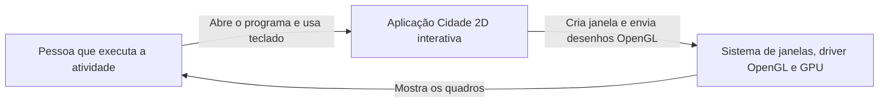
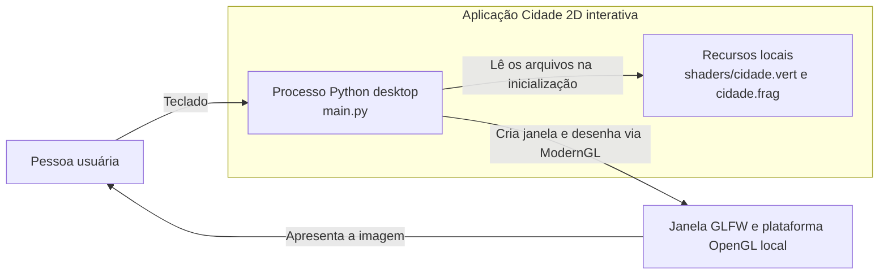
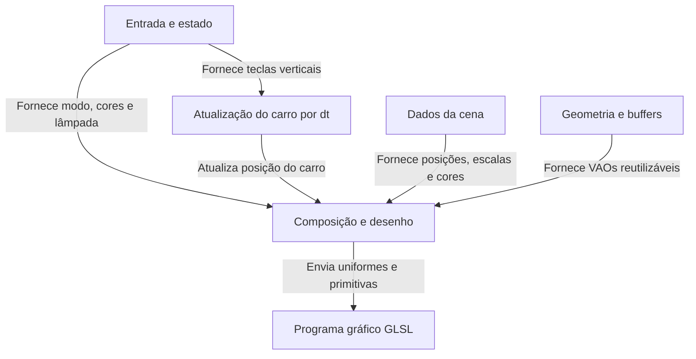

# Arquitetura C4 da cidade 2D interativa

## Escopo e evidências

Esta documentação cobre somente `Versao_final`, a aplicação desktop preparada para a atividade. O arquivo de entrada é `main.py`. O diretório `shaders/` contém os dois programas GLSL lidos na inicialização. `Predio.py`, `Porta.py`, `Solo.py` e `Corpo_celeste.py` guardam dados da cena; nenhum deles é um executável separado.

Observações verificadas no código:

- `main.py` pede uma janela GLFW com OpenGL 4.0 Core e usa ModernGL para criar programa, buffers e malhas. NumPy gera os vértices de círculo e retângulo.
- A mesma malha de retângulo é reutilizada com `TRIANGLES`; a circular usa `TRIANGLE_FAN`. O carro combina as duas. Os objetos mudam de tamanho, posição e cor por uniformes, sem refazer as malhas.
- O callback `tecla` alterna dia/noite, cores do prédio central e do carro, e estado da lâmpada. O laço consulta as setas para cima e para baixo e chama `atualizar_carro(dt)` a cada quadro.
- A posição horizontal do carro avança com `VELOCIDADE_CARRO * dt`. O valor de `dt` vem de duas leituras sucessivas de `glfw.get_time()`. Ao cruzar o limite direito, o cálculo modular o faz reaparecer à esquerda.
- `cidade.vert` aplica escala e deslocamento. `cidade.frag` atenua a cena no modo noite e calcula a contribuição local do poste pela distância entre o fragmento e a posição da lâmpada. A coordenada local da malha suaviza a transparência do halo circular da lâmpada e da elipse projetada sobre o asfalto.
- O código observado não tem servidor, banco de dados, autenticação ou chamadas de rede.

A pessoa que opera o programa é inferida a partir dos controles e do enunciado. O sistema operacional, o driver OpenGL e a GPU são dependências do computador onde ele roda. Não fazem parte do código entregue.

## Nível 1: contexto do sistema

Uma pessoa executa a cidade e usa o teclado para alterar a cena. A aplicação envia comandos à plataforma gráfica local, que apresenta os quadros na tela.

## Nível 2: contêiner

No vocabulário C4, contêiner é uma unidade executável. Aqui há um único contêiner desenvolvido pelo grupo: o processo Python iniciado por `main.py`. Os shaders são arquivos lidos por esse processo, não serviços ou contêineres adicionais. GLFW, ModernGL e NumPy são bibliotecas carregadas no processo. A comunicação com a plataforma OpenGL é local, sem rede.

## Nível 3: componentes do processo Python

| Componente lógico | Responsabilidade | Evidência no projeto |
| --- | --- | --- |
| Entrada e estado | Guarda `noite`, `lampada_acesa`, `indice_cor_predio` e `cor_carro`; recebe as teclas `D`, `C`, `L` e `Esc`. | Callback `tecla` e variáveis em `main.py`. |
| Atualização do carro | Avança o carro para a direita por tempo decorrido, consulta as setas verticais e limita a altura à pista. | `atualizar_carro(dt)`, `glfw.get_time()` e `glfw.get_key()`. |
| Dados da cena | Guarda posição, escala e cor de prédios, portas, solo e corpo celeste; cada prédio também guarda porta e janelas. | `Predio.py`, `Porta.py`, `Solo.py`, `Corpo_celeste.py`. |
| Geometria e recursos de GPU | Gera círculo, retângulo e índices; cria VBOs, EBO e VAOs reutilizados por vários objetos. | `leque`, `curva_circulo`, `curva_retangulo`, `indices_retangulo` e `montar`. |
| Composição e desenho | Monta nuvens, árvores, poste, halo, carro e edifícios na ordem de sobreposição; envia uniformes e chama as primitivas. | Funções `desenhar_*`, `desenhar` e laço principal. |
| Programa gráfico | Transforma os vértices; aplica atenuação, emissão, alcance da lâmpada e transparência dos halos circular e elíptico aos fragmentos. | `shaders/cidade.vert`, `shaders/cidade.frag` e uniformes definidos em `main.py`. |

O ciclo por quadro mede `dt`, atualiza o carro, ajusta os uniformes globais, limpa o fundo e desenha os objetos. Depois, troca os buffers e coleta eventos de teclado. Como o projeto não habilita teste de profundidade, a ordem das chamadas decide o que aparece à frente.

## Limites e próximos refinamentos

O cálculo de luz usa distância na cena 2D e uma transição suave. Ele clareia objetos próximos ao poste, mas não calcula sombras, reflexão ou iluminação fisicamente correta. A velocidade horizontal é constante nas unidades da cena por segundo; o deslocamento de cada quadro muda com `dt`, como previsto no material da disciplina.

O arquivo principal concentra inicialização, estado, desenho e laço. Isso mantém o exercício fácil de acompanhar, mas executar uma importação de `main.py` já tenta abrir a janela. Testes automatizados de lógica isolada exigiriam separar essa inicialização. O repositório inspecionado também não registra versões exatas das bibliotecas; a execução depende do ambiente Python configurado para a disciplina.
